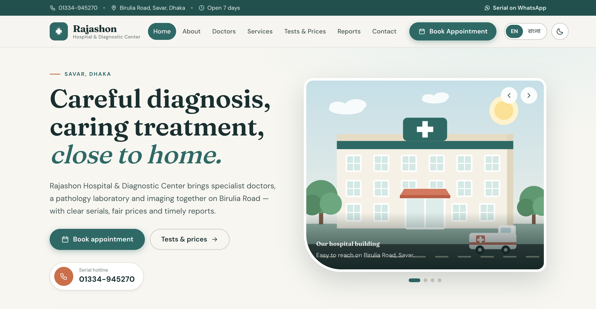

# Rajashon Hospital & Diagnostic Center

Complete design and implementation reference for the Rajashon Hospital & Diagnostic Center website. This document is intended to help another AI agent understand, audit, recreate, or extend the entire website without needing to infer the visual system from screenshots alone.

## Demo previews

### Desktop



## Project overview

- **Framework:** Astro 7, static output
- **Languages:** English and Bangla (`en` / `bn`)
- **Default language:** English
- **Default theme:** Day/light mode
- **Responsive layout:** Desktop, tablet, and mobile breakpoints
- **Primary audience:** Hospital patients in Savar, Dhaka
- **Main conversion:** Appointment booking and serial requests through WhatsApp/phone
- **Content status:** The doctor names, schedules, test prices, and illustrations are demo/sample content until replaced in `src/data/`

## Run locally

```bash
npm install
npm run dev
npm run build
npm run preview
```

The development server runs at `http://localhost:4321`.

## Page and route inventory

| Route | Purpose |
|---|---|
| `/` | Hero slider, key statistics, hospital introduction, featured doctors, contact cards, and test preview |
| `/about` | Hospital story, values, facilities, and location information |
| `/doctors` | Doctor directory, availability day chips, and doctor profile modal |
| `/services` | Diagnostic and clinical service categories |
| `/tests` | Searchable/filterable tests and prices explorer |
| `/reports` | Report collection and report-related information |
| `/appointment` | Calendar-based appointment/serial request form |
| `/contact` | Phone, WhatsApp, email, address, map, and opening hours |
| `/404` | Branded not-found page |

## Source structure

```text
src/
  components/       Reusable Astro UI components
  data/
    site.ts         Hospital identity, contact details, hours, images
    doctors.ts      Doctor profiles, specialties, schedules, photos
    services.ts     Services and report types
    tests.ts        Tests, categories, prices, preparation information
  layouts/
    Base.astro      HTML shell, theme bootstrap, language bootstrap
  lib/
    i18n.ts         Bilingual types and number/localization helpers
  pages/            Route-level pages
  scripts/
    app.ts          Language, theme, navigation, banner, reveal behavior
  styles/
    global.css      Design tokens and all global/component styles
public/images/      SVG and raster image assets
```

## Design system

All reusable colors are defined as CSS custom properties in `src/styles/global.css`. Components should use these variables instead of introducing new hard-coded colors.

### Day/light theme colors

| Token | Hex value | Intended use |
|---|---:|---|
| `--bg` | `#f7f6f1` | Main page background |
| `--bg-2` | `#efede4` | Secondary/tinted page sections |
| `--surface` | `#ffffff` | Cards, panels, header surfaces, modal surfaces |
| `--surface-2` | `#faf9f5` | Form fields and subtle inner surfaces |
| `--ink` | `#12302f` | Primary text and headings |
| `--ink-2` | `#3d5654` | Secondary body text and descriptions |
| `--ink-3` | `#647b79` | Muted text, metadata, placeholders, inactive labels |
| `--line` | `#e0ded3` | Standard borders and separators |
| `--line-2` | `#cfcdc0` | Stronger borders, outlines, and ghost buttons |
| `--brand` | `#0a6b66` | Main teal brand, primary buttons, links, active states |
| `--brand-d` | `#07514d` | Dark brand shade, topbar, primary-button hover |
| `--brand-ink` | `#ffffff` | Text/icons placed on the brand background |
| `--brand-soft` | `#e1f0ed` | Soft teal badges, chips, helper panels, hover backgrounds |
| `--accent` | `#d8693f` | Orange accent, eyebrow marker, required-field marker, alerts |
| `--accent-soft` | `#fbe9e1` | Form messages and soft accent panels |
| `--on-bg` | `#1d8a4c` | Availability/success green |
| `--on-ink` | `#ffffff` | Text/icons on availability green |
| `--on-soft` | `#e3f4ea` | Soft success background and check icons |
| `--off-bg` | `#eceae0` | Unavailable days and inactive calendar dates |
| `--off-ink` | `#8a9795` | Text for unavailable days |

### Night/dark theme colors

The dark theme is activated by `html[data-theme='dark']`. The same semantic tokens are overridden so components automatically adapt without separate markup.

| Token | Night value | Intended use |
|---|---:|---|
| `--bg` | `#0b1b1b` | Main dark page background |
| `--bg-2` | `#0f2323` | Dark secondary sections |
| `--surface` | `#132928` | Dark cards and panels |
| `--surface-2` | `#163030` | Dark form fields and inner surfaces |
| `--ink` | `#e9f2f0` | Primary light text |
| `--ink-2` | `#bcd0cd` | Secondary light text |
| `--ink-3` | `#8fa8a5` | Muted text and metadata |
| `--line` | `#234341` | Dark borders |
| `--line-2` | `#2d5552` | Stronger dark borders |
| `--brand` | `#3fc2b6` | Brighter teal for dark-background contrast |
| `--brand-d` | `#6fd8cd` | Dark-theme hover/highlight shade |
| `--brand-ink` | `#062524` | Dark text on bright teal |
| `--brand-soft` | `#15403d` | Dark soft teal surfaces |
| `--accent` | `#f08a62` | Brighter dark-theme orange accent |
| `--accent-soft` | `#3a261f` | Dark orange message background |
| `--on-bg` | `#36c477` | Brighter availability green |
| `--on-ink` | `#052414` | Dark text on availability green |
| `--on-soft` | `#143b27` | Dark success surface |
| `--off-bg` | `#1a2f2e` | Dark inactive day/calendar background |
| `--off-ink` | `#6f8886` | Dark inactive text |

### Fixed/special-purpose colors

These are intentionally fixed rather than theme-tokenized:

- Demo notice bar: background `#2b2a1f`, text `#f6ecb8`
- Desktop topbar: background `var(--brand-d)`, text `#e6f6f3`
- Dark topbar: background `#07302e`, text `#cde9e5`
- Hero image captions: white text over a dark `rgba(5, 32, 30, 0.82)` bottom gradient
- WhatsApp booking submit button: `#1fa457`; hover `#178a47`
- White CTA button: background `#ffffff`, text `#07514d`
- White outline CTA: white border with `rgba(255, 255, 255, 0.55)` and translucent white hover
- Mobile navigation scrim: `rgba(5, 22, 21, 0.5)`

## Typography and fonts

Fonts are imported in `src/layouts/Base.astro`:

1. **Fraunces Variable**
   - Package: `@fontsource-variable/fraunces`
   - Used for English headings, hero headlines, statistics, story numbers, badges, and prominent display text.
   - Fallbacks: `Hind Siliguri`, Georgia, serif.

2. **DM Sans Variable**
   - Package: `@fontsource-variable/dm-sans`
   - Used for English body text, navigation, labels, buttons, metadata, and UI controls.
   - Fallbacks: `Hind Siliguri`, system UI, `Segoe UI`, sans-serif.

3. **Hind Siliguri**
   - Package: `@fontsource/hind-siliguri`
   - Imported Bengali weights: 400, 500, 600, and 700.
   - Used for all Bangla body text and Bangla headings.
   - Fallbacks: `Noto Sans Bengali`, system sans-serif.

Typography behavior:

- English body size is `16.5px` with `1.65` line-height.
- Bangla body uses `1.8` line-height for readability.
- English headings use weight `600`, tight `1.2` line-height, and slight negative letter spacing.
- Bangla headings use weight `700`, `1.35` line-height, and no negative letter spacing.
- Eyebrows use uppercase tracking in English; Bangla removes uppercase transformation and reduces letter spacing.
- Focus outlines use a 3px brand-teal outline with 2px offset.

## Buttons and interactive colors

### Primary button: `.btn-primary`

- Background: `var(--brand)`
- Text/icon: `var(--brand-ink)`
- Shadow: brand-colored 35% mixed shadow
- Hover: `var(--brand-d)` and slight upward translation
- Used for: Book Appointment, main conversion actions, active mobile navigation item

### Ghost button: `.btn-ghost`

- Transparent background
- Border: `var(--line-2)`
- Text: `var(--ink)`
- Hover: brand border/text and `var(--brand-soft)` background
- Used for secondary actions such as Tests & Prices

### Soft button: `.btn-soft`

- Background: `var(--brand-soft)`
- Text: `var(--brand)`
- Hover: brand background with brand-ink text
- Used for low-emphasis content actions

### Light and outline-light buttons

- `.btn-light`: white background with dark teal text; hover uses soft teal
- `.btn-outline-light`: translucent white border/text for dark/image backgrounds

### Other controls

- `.icon-btn`: circular 42px control with surface background and line border; hover changes border/icon to brand teal.
- `.chip`: pill-shaped soft teal label; hover changes to solid brand teal.
- `.link-arrow`: brand-colored text link; arrow translates 4px on hover.
- `.day.is-on`: green available day with white text.
- `.day.is-off`: muted beige day with line-through text.
- Selected appointment calendar date: brand background, brand-ink text, and a double-ring outline.

## Day/night mode behavior

Theme logic lives in `src/scripts/app.ts` and is initialized early in `Base.astro`.

### Initialization

1. `Base.astro` reads `localStorage.getItem('rj-theme')` before the page is displayed.
2. If the stored value is `dark`, it sets `html[data-theme="dark"]`.
3. Otherwise the page starts in day mode.
4. The `<meta name="theme-color">` value is synchronized:
   - Day: `#f7f6f1`
   - Night: `#0b1b1b`

### Toggle behavior

- The header moon/sun icon button toggles between light and dark.
- The selected theme is saved in `localStorage` under `rj-theme`.
- CSS variables change globally, so cards, text, borders, forms, buttons, calendar states, doctor cards, and footer adapt together.
- The body transitions background and text colors over `0.3s`.
- Header and component shadows become darker and stronger in night mode.
- The mobile drawer and all surfaces use the active theme surface variables.

### Visual effects

- Sticky header uses a translucent background mixed from the active page background plus `backdrop-filter: blur(12px)`.
- Once the page scrolls more than 8px, the header receives `var(--shadow-m)`.
- Desktop cards use theme-aware borders and shadows.
- Dark mode keeps the same teal/orange identity but increases contrast with brighter brand and accent colors.
- `color-scheme: light/dark` is set on the root theme so native controls can follow the active mode.
- Theme state survives page reloads through local storage.

## Language switching

- The language toggle offers `EN` and `বাংলা`.
- The root HTML language changes between `en` and `bn`.
- Elements with `.l-en` and `.l-bn` are shown/hidden using the root language.
- Bilingual content is represented as `{ en, bn }` objects and rendered through the `T` component.
- Placeholders, aria labels, and document titles are updated by `app.ts`.
- Language preference is saved in `localStorage` under `rj-lang`.
- Bangla digits are supported through `bnDigits()` in `src/lib/i18n.ts`.

## Layout, animation, and responsive behavior

- Main content uses centered `.wrap` containers with a maximum width of 1200px.
- Narrow text layouts use an 820px maximum width.
- Border radii:
  - `--r-s`: 8px
  - `--r-m`: 14px
  - `--r-l`: 22px
- Shadows:
  - `--shadow-s`: subtle card elevation
  - `--shadow-m`: standard card/header elevation
  - `--shadow-l`: modal, drawer, and hero image elevation
- `.reveal` elements start 18px lower and transparent, then animate into place over `0.6s`.
- Reveal animations use `IntersectionObserver`; fallback immediately shows content.
- `prefers-reduced-motion: reduce` disables reveal transitions and smooth scrolling.
- Doctor cards lift 4px and gain a shadow on hover.
- Story images scale to `1.04` on hover.
- Mobile drawer slides in from the right with staggered navigation-item animation.
- Mobile drawer uses a blurred/dimmed scrim and locks body scrolling.
- The desktop navigation changes to a right-side drawer at widths below 1041px.
- Grid layouts collapse progressively for tablet and mobile widths.

## Header and footer behavior

The header contains:

- Dismissible demo-content notice
- Phone number, location, and opening status topbar
- WhatsApp serial link
- Logo and desktop navigation
- Book Appointment CTA
- English/Bangla switcher
- Day/night toggle
- Mobile menu button

The demo notice is controlled by `site.showDemoBanner`. Closing it removes the banner and stores `rj-banner` in session storage for the current browser session.

The footer contains:

- Light logo
- Hospital description
- Quick links
- Address and landmark
- Multiple phone links
- Email link
- Opening hours
- Emergency message
- Copyright and medical-information disclaimer

## Functional behavior

- Appointment booking includes availability calendar/day selection.
- Booking form validates user fields and opens a WhatsApp request flow.
- Doctor cards show specialty, degrees, availability days, timings, and booking actions.
- Doctor profile details open in an accessible modal.
- Tests page supports search and category filtering.
- Hero slider includes image captions, navigation controls, and active slide dots.
- Contact links use `tel:`, `mailto:`, WhatsApp, and map destinations.
- Navigation tracks the current route using `aria-current="page"`.
- Keyboard escape closes the mobile drawer and modal-related UI.
- Visible focus states and skip navigation support keyboard accessibility.

## Content and asset editing guide

All site content, images, doctor profiles, service details, and test pricing are centralized in `src/data/` so you can update them in one place without touching page HTML or Astro components.

### 📸 How to update images and photos (ছবি পরিবর্তনের নিয়ম)

> **Quick Tip:** Search for the emoji **`📸`** across the project (or in your editor using `Ctrl+Shift+F` / `Cmd+Shift+F`) to instantly jump to every image setting in the code!

You can use **either**:
1. **Direct Web URLs (অনলাইন লিঙ্ক):** Paste any direct image link (`https://...`). Works with any image hosting, CDN, or cloud storage (e.g., Unsplash, Cloudinary, Imgur, direct server URLs).
2. **Local files (লোকাল ফাইল):** Put your image file inside `public/images/` and use the relative path (e.g., `photo: '/images/doctors/dr-name.jpg'`).

---

#### 1. Hospital Building Photo (আমাদের হসপিটাল ভবন)
- **File:** `src/data/site.ts`
- **Location:** `images.building`
- **Where it appears:**
  - Homepage ("About our hospital" section)
  - About page (`/about`)
- **Example:**
  ```ts
  // 📸 HOSPITAL BUILDING PHOTO: Shown on Homepage & About page
  building: 'https://cdn.britannica.com/12/130512-004-AD0A7CA4/campus-Riverside-Ottawa-The-Hospital-Ont.jpg',
  ```

---

#### 2. Hero Slider / Banner Photos (হোমপেজ স্লাইডার ব্যানার)
- **File:** `src/data/site.ts`
- **Location:** `images.slides`
- **Where it appears:** Main hero carousel on the homepage (`/`)
- **Configured slides:**
  - **Slide 1:** আমাদের হসপিটাল ভবন (Our hospital building)
  - **Slide 2:** প্যাথলজি ল্যাবরেটরি (Pathology laboratory)
  - **Slide 3:** এক্স-রে ও আল্ট্রাসনোগ্রাফি (X-ray & ultrasonography)
  - **Slide 4:** ডাক্তার ও রোগীসেবা (Doctors & patient care)
- **Example:**
  ```ts
  slides: [
    {
      // 📸 SLIDE 1: আমাদের হসপিটাল ভবন (Our hospital building)
      src: 'https://cdn.britannica.com/12/130512-004-AD0A7CA4/campus-Riverside-Ottawa-The-Hospital-Ont.jpg',
      title: { en: 'Our hospital building', bn: 'আমাদের হসপিটাল ভবন' } as Bi,
      text: { en: 'Easy to reach on Birulia Road, Savar.', bn: 'সাভারের বিরুলিয়া রোডে সহজে পৌঁছানো যায়।' } as Bi,
    },
    ...
  ]
  ```

---

#### 3. Doctor Photos & Profiles (ডাক্তারদের ছবি ও প্রোফাইল)
- **File:** `src/data/doctors.ts`
- **Location:** `doctors` array -> `photo` field of each doctor
- **Where it appears:**
  - Homepage featured doctor cards
  - Doctors page directory (`/doctors`)
  - Doctor profile modal popup
  - Appointment booking summary card (`/appointment`)
- **Example:**
  ```ts
  {
    slug: 'dr-sample-medicine',
    name: { en: 'Dr. Md. Anwar Hossain', bn: 'ডা. মো. আনোয়ার হোসেন' },
    // 📸 DOCTOR PHOTO: Change URL or local file path
    photo: 'https://images.unsplash.com/photo-1622253692010-333f2da6031d?auto=format&fit=crop&w=800&q=80',
    specialty: { en: 'Medicine Specialist', bn: 'মেডিসিন বিশেষজ্ঞ' },
    ...
  }
  ```
  *(Note: If `photo` is left empty `''`, a clean neutral silhouette illustration is automatically shown.)*

---

#### 4. Service Photos (ডায়াগনস্টিক ও ক্লিনিক্যাল সেবা)
- **File:** `src/data/services.ts`
- **Location:** `services` array -> `image` field
- **Where it appears:**
  - Services page (`/services`)
  - About page photo story (`/about`)
- **Services with photos:**
  - `opd`: Outdoor Consultation / Chamber (আউটডোর চিকিৎসা)
  - `pathology`: Pathology Laboratory (প্যাথলজি ল্যাবরেটরি)
  - `xray`: X-Ray (এক্স-রে)
  - `usg`: Ultrasonography (আল্ট্রাসনোগ্রাফি)
  - `ecg`: ECG & Echocardiography (ইসিজি ও ইকোকার্ডিওগ্রাফি)
  - `emergency`: Emergency & Ambulance (জরুরি সেবা ও অ্যাম্বুলেন্স)

---

### 📝 How to update other hospital information

| What to update | File to edit | Details |
|---|---|---|
| **Hospital Name, Address & Map** | `src/data/site.ts` | `site.name`, `site.address`, `site.landmark`, `site.mapQuery` |
| **Phone Numbers & WhatsApp** | `src/data/site.ts` | `site.phones`, `site.whatsapp` (receives online appointment requests) |
| **Opening Hours & Emergency** | `src/data/site.ts` | `site.hours`, `site.emergency` |
| **Demo Notice Banner** | `src/data/site.ts` | Set `showDemoBanner: false` before going live |
| **Doctors, Degrees & Fees** | `src/data/doctors.ts` | `name`, `specialty`, `degrees`, `days`, `time`, `fee`, `about` |
| **Tests, Categories & Prices** | `src/data/tests.ts` | `name`, `cat`, `price` (in BDT), `report` (turnaround time), `prep` |
| **Services & Facilities** | `src/data/services.ts` | `title`, `text`, `icon`, `image` |

### 🚀 Verifying your changes locally

After updating any image URL or file:
1. Run the development server:
   ```bash
   npm run dev
   ```
2. Open `http://localhost:4321` in your browser.
3. Test static build before deploying:
   ```bash
   npm run build
   ```

## AI handoff checklist

When giving this project to another AI agent, ask it to:

1. Read this README first.
2. Treat `src/styles/global.css` as the source of truth for colors, spacing, radii, shadows, buttons, responsive behavior, and theme overrides.
3. Treat `src/layouts/Base.astro` and `src/scripts/app.ts` as the source of truth for theme/language initialization and persistence.
4. Preserve the semantic color roles (`brand`, `accent`, `on`, `off`) instead of replacing individual components with unrelated colors.
5. Preserve both English and Bangla content paths.
6. Preserve `prefers-reduced-motion`, focus-visible styles, keyboard behavior, and accessible labels.
7. Check both day and night modes at desktop and mobile widths after any UI change.
8. Run `npm run build` before considering the work complete.

## Deployment notes

The site is configured as a static Astro build. Vercel can deploy it with:

```bash
npm install
npm run build
```

The `@fontsource-variable/fraunces`, `@fontsource-variable/dm-sans`, and `@fontsource/hind-siliguri` packages must be installed from `package.json` and represented in the lockfile so clean deployment environments can resolve the imports used by `Base.astro`.
